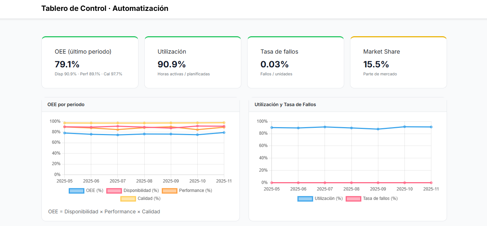
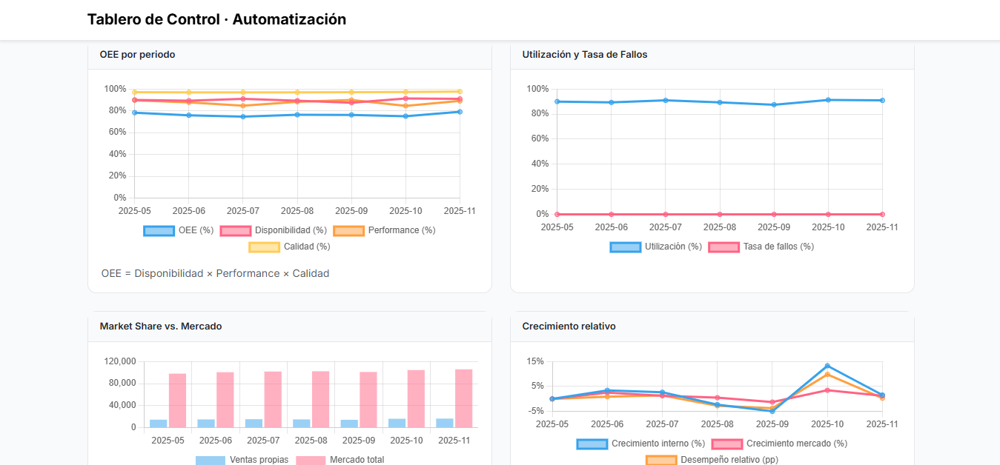

# Tablero de control OEE para automatización industrial


Tablero web que mide el desempeño de una línea automatizada y lo cruza con el mercado. A partir de datos mensuales calcula **OEE, utilización, tasa de fallos y market share**, y los muestra con semáforos y gráficos de evolución.

**Demo:** https://jz-rs.github.io/tablero-control-oee/



## Problema de negocio

Una planta automatizada tiene las métricas técnicas (eficiencia, fallas) separadas de las estratégicas (participación de mercado), y eso dificulta decidir si la automatización mejora la competitividad. El tablero las junta en una sola vista con tres objetivos:

1. Aumentar la eficiencia de los procesos automatizados.
2. Reducir los fallos y las interrupciones.
3. Evaluar si la mejora interna se traduce en participación de mercado.

## Indicadores

| Indicador | Cómo se calcula | Semáforo (verde / amarillo) |
|---|---|---|
| **OEE** | Disponibilidad × Performance × Calidad | ≥ 70 % / ≥ 60 % |
| Disponibilidad | (horas planificadas − horas de parada) / horas planificadas | — |
| Performance | unidades producidas / (120 unid/h × horas de funcionamiento) | — |
| Calidad | unidades buenas / unidades producidas | — |
| **Utilización** | horas de funcionamiento / horas planificadas | ≥ 85 % / ≥ 75 % |
| **Tasa de fallos** | fallos / unidades producidas | ≤ 0,05 % / ≤ 0,10 % |
| **Market share** | ventas propias / ventas totales del mercado | ≥ 16 % / ≥ 14 % |
| Crecimiento relativo | crecimiento de las ventas propias − crecimiento del mercado (en puntos porcentuales) | — |

La tasa ideal de 120 unidades por hora es un parámetro (`IDEAL_RATE_UNITS_PER_HOUR` en `script.js`).

## Resultados con los datos de ejemplo

Último período (noviembre de 2025):

| Indicador | Valor |
|---|---|
| OEE | 79,1 % (disponibilidad 90,9 %, performance 89,1 %, calidad 97,7 %) |
| Utilización | 90,9 % |
| Tasa de fallos | 0,03 % |
| Market share | 15,5 % (en amarillo: el umbral verde es 16 %) |

En los siete períodos (mayo a noviembre de 2025):

- El OEE se movió entre 74,6 % y 79,1 %, y la utilización entre 87,5 % y 91,3 %.
- La tasa de fallos estuvo entre 0,03 % y 0,06 %. Septiembre superó el umbral verde de 0,05 %.
- El market share osciló entre 14,2 % y 15,5 %.
- Las ventas propias crecieron más que el mercado en 4 de las 6 comparaciones (junio, julio, octubre y noviembre). El pico fue octubre, con +9,8 puntos porcentuales.



### Cómo leer el crecimiento relativo

| Escenario | Qué significa |
|---|---|
| Mejora interna + crecimiento externo | La automatización mejora la eficiencia y aumenta el market share |
| Mejora interna sin crecimiento externo | La eficiencia mejora, pero no se refleja en el mercado |
| Retroceso interno + mercado estable | Baja la eficiencia mientras el mercado se mantiene |

## Datos

`data.json` trae **datos de ejemplo** de siete meses, con un registro por período:

| Campo | Significado |
|---|---|
| `period` | Mes (`AAAA-MM`) |
| `planned_hours`, `runtime_hours`, `downtime_hours` | Horas planificadas, de funcionamiento y de parada |
| `production_units`, `good_units` | Unidades producidas y unidades buenas |
| `failures` | Cantidad de fallos |
| `sales_internal`, `sales_market_total` | Ventas propias y ventas totales del mercado |

## Cómo ejecutarlo

La página carga `data.json` con `fetch`, así que hay que abrirla desde un servidor local. Si se abre el `index.html` con doble clic, el navegador bloquea la carga de datos.

```bash
python -m http.server 8000
```

Después, abrí http://localhost:8000. También sirve la extensión Live Server de VS Code. Necesita conexión a internet porque Bootstrap, Chart.js y la tipografía se cargan desde CDN.

## Tecnologías

HTML5, CSS3, JavaScript sin frameworks, Bootstrap 5.3, Chart.js 4.4, Google Fonts (Inter) y JSON.

## Estructura

```
├── index.html      Estructura de la página y tarjetas de KPI
├── script.js       Cálculo de indicadores, semáforos y gráficos
├── style.css       Estilos
├── data.json       Datos de ejemplo
├── img/            Capturas del README
└── README.md
```

## Límites y próximos pasos

- Los datos se leen de un JSON estático. Para monitorear en tiempo real habría que conectar una fuente en vivo: una API, una base de datos o MQTT.
- Los umbrales de los semáforos y la tasa ideal están fijos en el código; pasarlos a un archivo de configuración.
- `script.js` ya calcula el MTBF (tiempo medio entre fallos), pero todavía no se muestra en el tablero.

## Autoría

Lo desarrollamos con Juana Ruiz Luque.
